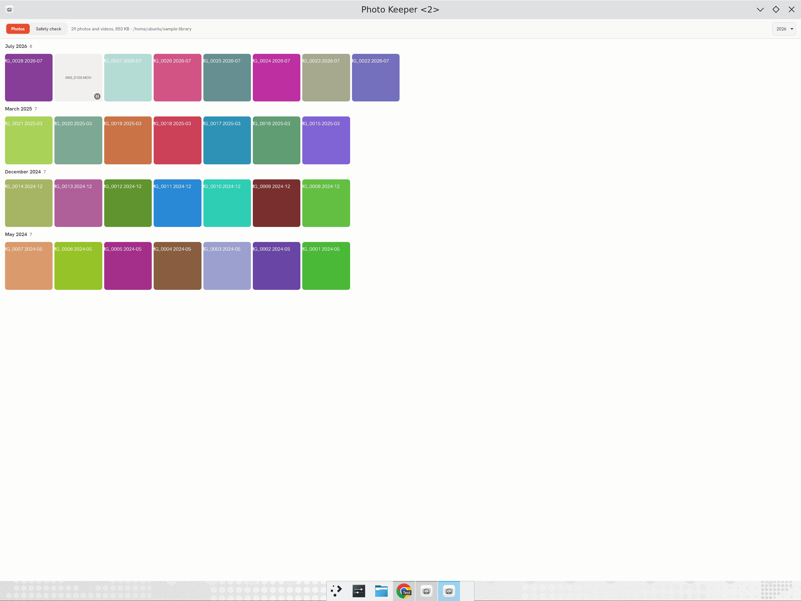
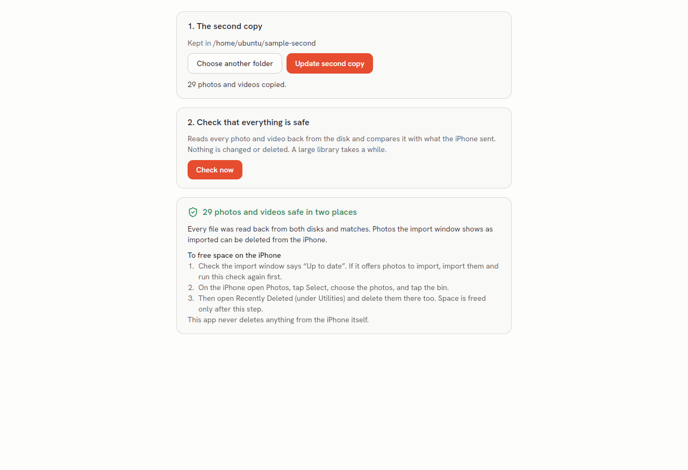

# Photo Keeper

A desktop app for Mac and Windows that copies the photos and videos from an
iPhone over a USB cable to a folder (an external drive works), proves each copy
matches, keeps a second copy on another disk, and shows the library by month.

It is built on [Rollport](https://github.com/artificiadrian/rollport) by
artificiadrian (MIT). Rollport does the talking to the iPhone; Photo Keeper adds
the checksums, the second copy, the safety check and the library window.




## Using it

1. Plug the iPhone in, unlock it, tap Trust.
2. Choose the folder the photos go to (once), press **Import** and watch them
   copy. Each file is read back from the disk and compared with what the iPhone
   sent before it counts as imported.
3. Press **Photos & safety** to open the library window.
4. On **Safety check**: choose a folder on a _different disk_ for the second
   copy (once), press **Update second copy**, then **Check now**.
5. Only when it says **safe in two places** delete the photos on the iPhone, in
   the Photos app, and then empty Recently Deleted.

The app never deletes anything, on the iPhone or on the disks.

A drive used on both Mac and Windows has to be formatted exFAT.

## Changing how it looks

Ask your AI assistant. It reads [AGENTS.md](AGENTS.md), which says what is safe
to change (colours, layout, wording, the grid) and what is not (the code that
copies and checks photos).

## Working on it

Rust 1.90+, Node.js 22.18+, pnpm 11 and Tauri's
[prerequisites](https://v2.tauri.app/start/prerequisites/).

```sh
pnpm install --frozen-lockfile   # also installs the git hooks
pnpm tauri dev                   # run the app
pnpm check && pnpm test          # the window: types and tests
cd src-tauri && cargo clippy --all-targets -- -D warnings && cargo test
pnpm tauri build                 # an installer for the system you are on
```

Pushing a tag like `v0.2.0` builds unsigned Mac and Windows installers onto a
draft GitHub release. Unsigned means the Mac asks for right-click → Open the
first time, and Windows shows "More info → Run anyway".

See [MISSION.md](MISSION.md), [DECISIONS.md](DECISIONS.md) and
[STATUS.md](STATUS.md).
